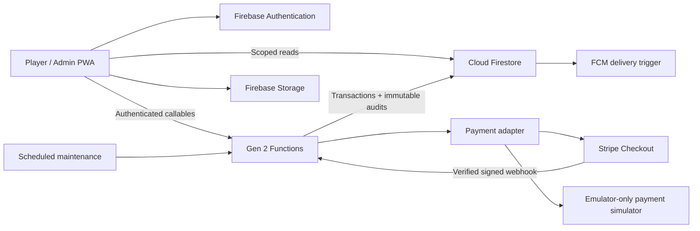

# PPRC Events architecture

## Boundaries

The existing root Next.js app, `app/`, `lib/`, and `data/baseline.db` remain independent. Root TypeScript excludes the new workspaces. PPRC Events is a React 18/Vite PWA in `apps/web`, Gen 2 Firebase Functions in `functions`, and shared TypeScript/Zod domain logic in `packages/shared`. It never reads or writes ladder or legacy SQLite paths.

## Transaction model

Every domain operation runs in a Firestore transaction. It reads the actor's trusted membership, profile, event and scoped records before writing. Group membership and standings are stored as arrays of maps (`{players}` / `{rows}`), because Firestore does not support directly nested arrays.

The event-scoped registration query protects capacity against concurrent insertions; all entrants are evaluated against event and division capacity. A user-level registration limit also serializes abusive registrations across events. A durable `operationRequests/{uid-requestId}` receipt stores the request hash and response. Exact retries return the original response; changed payloads cannot reuse the ID.

The transaction writes only changed documents, a server-timestamped audit record and the receipt. Active registrations are Pending Payment, Registered or Approved. Waitlist order uses server arrival time and an ID tie-break. Withdrawal/rejection immediately promotes eligible entries transactionally. After draw generation, entries are locked against new registrations and promotion; withdrawals are still recorded, and administrators receive a notification to resolve scheduled matches as walkovers. Paid promotions have a 30-minute payment reservation. Maintenance expires reservations every five minutes. The write limit is capped at 400 before Firestore commit.

Stripe session creation is an external side effect and uses the immutable payment ID as Stripe's idempotency key. Payment webhooks verify signature, session binding, currency and amount. A late payment cannot reclaim a reallocated place: it becomes `Refund Required` for administrative reconciliation. Refunds use Stripe's idempotency key and are recorded after Stripe confirms success. A retry recovers a crash between the provider call and the database update. Stripe Checkout retains the provider's session expiry; the PPRC place reservation is independent. Expiry parameters are not regenerated under a reused Stripe idempotency key. Full refunds require a withdrawal/cancellation and an explicit audit reason. Production payment and refund paths require Stripe test validation before deployment.

## Data

Top-level collections: users (private full profiles), publicProfiles (minimal opt-in identity), clubs, memberships, venues, courts, events, divisions, registrations, payments, draws, drawNodes, matches, matchResults, notifications, auditEvents, eventTemplates. Internal collections: operationRequests, registrationLimits, pushTokens, deletionRequests. IDs and club/event scope are included on domain documents; creation/update metadata uses server timestamps. Membership document IDs are Firebase UIDs. This version deliberately operates one club (`pprc`).

Players may read their own financial and registration records. Event admins read only assigned event operations. Club admins manage all PPRC events and roles. Platform support can read operations and audits, but cannot mutate them. Firestore clients cannot write payments, scores, draws or audits, including when signed in as an admin. Profile updates go through validated callables. The public profile projection excludes emergency contacts, birth dates, notification preferences and private availability.

## Tournament logic

Elimination uses mirrored deterministic seed placement, a power-of-two bracket and first-round byes. Winners advance only through finalized results. Round robin uses a circle rotation with no duplicated pairings. Groups are balanced by reference seed order. Playoffs are created after all group matches finish and qualification ties are resolved. Draw publication is independent from event publication. Versioned results retain corrections; superseded records remain in history. A scored downstream match blocks reopening its feeder. Group corrections are blocked once playoffs exist, avoiding inconsistent qualification.

Standings support configured wins, direct head-to-head for a two-player tie, set percentage, game percentage and explicit administrator resolution. Larger unresolved ties are flagged rather than silently treating lexical ID order as sporting merit. Match tiebreak points count as one set and are excluded from game percentage. Walkovers/defaults give a match win without invented set/game totals.

Scheduling uses event-local daily hours, selected courts, duration, buffer, blackouts and predecessor finish times. Court/player conflicts are validated server-side. This is a basic scheduler, not a multi-venue optimization engine. Time input fields explicitly say UTC; player-facing display uses the event timezone. Fixed hourly windows currently require a whole match plus its buffer to fit.

## Notifications and PWA

In-app notifications are transaction-created and refreshed by TanStack Query. Scheduled jobs create match reminders. A Firestore trigger delivers FCM messages only when the player opts in and production FCM is configured. Push uses a separate worker scope so it cannot replace the PWA's Workbox worker. Authenticated data and payments are not cached by the service worker. Offline support covers the application shell, not trusted writes. Reconnect before registering or scoring.

## Operations

Event capacity is capped at 128, total division capacities at 128 and generation at 400 changed records. An oversized round robin is rejected atomically; split it into groups or smaller divisions. Before larger-scale use, replace the event-wide transaction reads with inventory counters and chunked administrative jobs. Deploy Firestore TTL for operation receipts only after choosing a retention period longer than payment retry windows. Audit retention and account deletion require club policy and human review.
